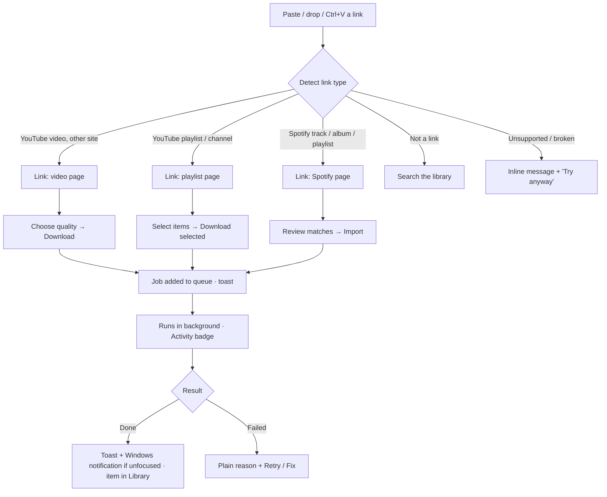

# Grab: Product, UX and Build Plan

> Personal Windows desktop app for downloading video and music, importing Spotify playlists,
> playing your music library, and simple video tools.
> Status: **planning** · Platform: **Windows 10/11** · Last updated: 2026-11-11

---

## 1. Product principles

These decide every design argument.

1. **One box does everything.** Paste any link anywhere and the app works out what it is (YouTube video, playlist, Spotify album, …) and opens the right screen. No "which tool do I use?" moment.
2. **Never block the user.** Downloads, imports and exports run in the background. You can keep browsing, listening and queueing while they work.
3. **Calm, content-first UI.** Cover art and thumbnails supply the colour; the interface stays quiet. One accent colour, used only for primary actions and the current state.
4. **Explain, don't error.** Every failure says what happened in plain words and offers the fix (Retry, Update, Open settings).
5. **Fast feels professional.** Instant navigation, skeletons instead of spinners, optimistic updates, keyboard shortcuts for everything frequent.
6. **Private and offline-first.** Everything runs locally. Nothing is uploaded and there are no accounts (except optional Spotify later).

---

## 2. Design system

### 2.1 Visual direction

**"Warm graphite + ember."** A dark-first media app (light theme fully supported) with warm neutral greys rather than cold blue-greys, and a single ember-orange accent. Large cover art, generous spacing, soft 10–14px radii, thin 1px borders instead of heavy shadows. The look is original; it does not copy any existing app.

### 2.2 Colour tokens

All colours are CSS variables, so themes switch instantly. Text/background pairs must meet **WCAG AA (4.5:1 for body text, 3:1 for large text and icons)**.

| Token | Dark (default) | Light | Use |
|---|---|---|---|
| `--bg` | `#0F0F0E` | `#F6F5F2` | App background |
| `--surface-1` | `#171715` | `#FFFFFF` | Cards, sidebar |
| `--surface-2` | `#1F1E1C` | `#F0EEE9` | Hover, inputs |
| `--surface-3` | `#292826` | `#E6E3DC` | Pressed, selected rows |
| `--border` | `#2E2D2A` | `#E2DFD7` | Dividers, outlines |
| `--text` | `#F2F0EB` | `#1A1915` | Primary text |
| `--text-muted` | `#A19E95` | `#56524B` | Secondary text |
| `--text-faint` | `#87857E` | `#6F6C65` | Hints, labels (AA on the backgrounds it's used on; adjusted in M6) |
| `--accent` | `#FF7A45` | `#C2410C` | Primary buttons, progress, active item |
| `--accent-hover` | `#FF8F61` | `#A93A0B` | |
| `--accent-fg` | `#1C0A02` | `#FFFFFF` | Text on accent (keeps AA contrast) |
| `--success` | `#3DBF7F` | `#15803D` | Done states |
| `--warning` | `#E3A53A` | `#B45309` | Needs attention |
| `--danger` | `#F0595E` | `#DC2626` | Errors, destructive |
| `--focus` | `#FF7A45` | `#C2410C` | 2px focus ring + 2px offset |

**Dynamic tint:** the Now Playing screen and the album/playlist headers take a soft gradient from the cover art's dominant colour, so screens feel alive while the UI stays neutral.

### 2.3 Typography

- **Inter (variable)** for all UI, **JetBrains Mono** only for paths, logs and technical values. Both are **bundled with the app**; there are no web font requests.
- Times, sizes and counters use tabular numbers (`font-variant-numeric: tabular-nums`) so they don't jitter.

| Style | Size / line height | Weight | Use |
|---|---|---|---|
| Display | 40 / 44 | 700 | Album/playlist titles |
| H1 | 28 / 34 | 650 | Page titles |
| H2 | 20 / 26 | 600 | Section titles |
| H3 | 16 / 22 | 600 | Card titles |
| Body | 14 / 20 | 400 | Default |
| Small | 13 / 18 | 400 | Secondary info |
| Caption | 12 / 16 | 500 | Labels, badges (uppercase +0.06em tracking only for section labels) |

### 2.4 Spacing, shape, elevation, motion

- **Spacing:** a 4px grid (4, 8, 12, 16, 20, 24, 32, 40, 48, 64). Page padding is 32px, card padding 16–20px.
- **Radius:** 6px for small controls, 10px for buttons, inputs and rows, 14px for cards and panels, 20px for dialogs, full for pills and avatars.
- **Elevation:** dark mode uses surface steps plus borders. Shadows are only for floating layers (menus, dialogs, toasts).
- **Motion:**
  - 120ms for hover and press, 200ms for panels and drawers, 320ms for the full-screen player and page hero.
  - Easing is `cubic-bezier(.2,.8,.2,1)`.
  - Everything respects `prefers-reduced-motion`.
- **Icons:** [Lucide](https://lucide.dev) at 1.75px stroke, 18px inline and 20px in navigation.
- **Density:** desktop targets are at least 32px tall; list rows are 56px with art and 44px compact.

### 2.5 Core components

Built on accessible headless primitives (Radix) and styled with our tokens:

| Component | Notes |
|---|---|
| Button | Primary (accent), Secondary (surface), Ghost, Danger. Sizes sm/md/lg. Shows a loading spinner inside when busy. |
| Icon button | Always has a tooltip and an `aria-label` |
| Input / Search / Smart link input | The smart input detects the link type and shows an icon (YouTube, Spotify, generic) while you type or paste |
| Select, Segmented control, Checkbox, Switch, Slider | Slider is used for seek and volume |
| Tabs | Underline style inside pages |
| Card / Media tile | Cover art 1:1 (music) or 16:9 (video), title, subtitle, hover play button |
| Track row | #, art, title/artist, album, like, duration, ⋯ menu; current-track state; multi-select |
| Progress bar / ring | Determinate and indeterminate |
| Badge | 4K, HDR, 60fps, Lossless, Explicit, status pills |
| Toast | Bottom-left; success, error and info; optional action ("Undo", "Show") |
| Dialog / Sheet | Dialogs for focused tasks (fix match, rename); right sheet for the Activity panel |
| Context menu | Right-click on any row or tile |
| Command palette | Ctrl+K: navigate, run actions, search the library |
| Empty state | Illustration-free: icon + one-line explanation + a primary action |
| Skeleton | Matches the final layout to avoid content shift |

---

## 3. App shell and layout

```
┌─────────────────────────────────────────────────────────────────────────────┐
│ ◉ grab   ‹ ›    [ 🔗 Paste a link or search your library…        Ctrl K ]  ─ □ ✕ │ Title bar 44px
├────────────┬────────────────────────────────────────────────┬───────────────┤
│ ⌂ Home     │                                                │ ACTIVITY      │
│ ↓ Activity │                                                │ (right sheet, │
│ ♪ Music    │                PAGE CONTENT                    │  Ctrl J,      │
│ ▶ Videos   │            (scrolls independently)             │  360px)       │
│ ✂ Tools    │                                                │               │
│            │                                                │               │
│ PLAYLISTS  │                                                │               │
│ ♥ Liked    │                                                │               │
│ • Road trip│                                                │               │
│ + New      │                                                │               │
│            │                                                │               │
│ ⚙ Settings │                                                │               │
├────────────┴────────────────────────────────────────────────┴───────────────┤
│ ▣ Song title     ♡  │   ⤨  ⏮  ( ▶ )  ⏭  ↻    │  ☰ Queue  ♫ Lyrics  🔊━━━  │ Player bar 76px
│   Artist            │ 0:42 ━━━━━━●────── 3:18  │                            │
└─────────────────────────────────────────────────────────────────────────────┘
```

- **Custom title bar** (Tauri window decorations off): logo, back/forward, the **smart link and search box** (the app's centre of gravity), and Windows-style window controls. The bar is draggable.
- **Sidebar** is 232px, collapses to a 72px icon rail below a 1100px window width or by user toggle. The Activity item shows a live count badge (for example "3").
- **Activity sheet** slides over from the right and doesn't push content. It opens automatically the first time you start a download, after which the badge is enough.
- **Player bar** is always visible once something has played. Clicking the art opens **Now Playing** full-screen.
- **Window:** default 1280×800, minimum 960×640. Position, size and sidebar state are remembered.
- **Global drop zone:** dropping a link or video file anywhere shows a full-window overlay ("Drop to download" / "Drop to open in Tools").
- **Global paste:** Ctrl+V while no input has focus sends the clipboard link to the smart box.

---

## 4. Pages

| # | Page | Route | Purpose |
|---|---|---|---|
| 1 | **Welcome** (first run) | `/welcome` | Three steps: choose download folder → theme → done |
| 2 | **Home** | `/` | Paste box, quick actions, active jobs, recent items, continue listening |
| 3 | **Link: video** | `/link?url=` | Preview and choose format/quality/options for one video |
| 4 | **Link: playlist / channel** | `/link?url=` | Select items, one quality for all, download selected |
| 5 | **Link: Spotify** | `/link?url=` | Track list with match status, format, import |
| 6 | **Activity** | `/activity` | Full page view of the queue and history (the sheet is the quick view) |
| 7 | **Music** | `/music` | Tabs: Songs · Albums · Artists · Liked |
| 8 | **Album** | `/music/album/:id` | Hero with cover tint, tracks, play/shuffle |
| 9 | **Artist** | `/music/artist/:id` | Hero, songs, albums |
| 10 | **Playlist** | `/music/playlist/:id` | Editable name and cover, drag-to-reorder tracks |
| 11 | **Now Playing** (overlay) | overlay | Large art, controls, queue tab, (lyrics later) |
| 12 | **Videos** | `/videos` | Grid of downloaded videos, sort and filter |
| 13 | **Video player** | `/videos/:id` | Built-in player with chapters and subtitles; "Open in Tools" |
| 14 | **Tools** | `/tools` | Hub: Merge · Trim · Compress · Convert/Extract audio |
| 15 | **Tool: Merge** | `/tools/merge` | Add clips → reorder → output settings → export |
| 16 | **Tool: Trim** | `/tools/trim` | Timeline with handles, fast (no re-encode) vs precise |
| 17 | **Tool: Compress** | `/tools/compress` | Target size presets (WhatsApp, Discord, Email, custom) |
| 18 | **Tool: Convert** | `/tools/convert` | Format presets, extract audio |
| 19 | **Settings** | `/settings/:section` | General · Downloads · Music · Tools · Spotify · Updates · Advanced · About |
| — | **Command palette** | overlay | Ctrl+K anywhere |

### 4.1 Home

```
Good evening
┌──────────────────────────────────────────────────────────────┐
│ 🔗  Paste a YouTube, Spotify or other link…         [ Go ]   │  big smart input
└──────────────────────────────────────────────────────────────┘
 Supports YouTube · YouTube Music · Spotify · 1000+ sites

[ ↓ Download video ] [ ♪ Spotify → music ] [ ⧉ Merge videos ] [ ✂ Trim ]   quick actions

IN PROGRESS (2)                                         View all →
 ▣ Video title ……………… ━━━━━━━━━──── 64% · 8.2 MB/s · 0:21 left   ‖ ✕

CONTINUE LISTENING
 [art][art][art][art][art][art]   horizontally scrolling tiles

RECENTLY ADDED
 [thumb][thumb][thumb][thumb]     videos and songs, mixed
```

- **Empty Home** (first run): only the paste box, quick actions and a short "How it works" with three steps.

### 4.2 Link: video

```
┌────────────┐  Video title (2 lines max)
│ thumbnail  │  Channel · 12:34 · 1.2M views
│   16:9     │
└────────────┘
[ Video ] [ Audio ]                                   segmented control
 ● 2160p  4K HDR 60fps   VP9        ~1.8 GB
 ○ 1440p       60fps   VP9        ~920 MB
 ○ 1080p       60fps   AVC        ~410 MB     ← default from settings
 ○ 720p ……
▸ More options                                       collapsible
   Subtitles  [English ▾] [+]  ( ) Embed  ( ) Separate file
   Section    [ 0:00 ] – [ 12:34 ]   Only download part of the video
   SponsorBlock  [ Remove sponsor segments ▾ ]
   Split by chapters  [ off ]
   Save to   C:\Users\…\Videos\Grab   [Change]
───────────────────────────────────────────────────────────────
 Saves to Videos › Grab                          [ Download ]
```

- **Audio tab** offers: **Best (Opus, original)**, **M4A (AAC, original)** and **MP3 (converted)**. Each shows a one-line explanation and size.
- After **Download**:
  - a toast says "Added to downloads";
  - the button turns into a live progress pill;
  - the user can paste the next link immediately.

### 4.3 Link: playlist / channel

- A header shows the playlist title, owner, count and total time.
- **Toolbar:**
  - select all / none;
  - a "Quality for all" select ("Best up to 1080p", "Audio only – Opus", …);
  - a search filter within the playlist.
- **Rows:** checkbox, thumbnail, title, duration, plus a status icon once queued.
- The primary button reads "Download 24 selected". Large playlists load progressively (virtualized list).

### 4.4 Link: Spotify

- **Hero:** cover, name, owner and song count, tinted by the cover colour.
- **Track rows:** checkbox, #, title/artist, duration, and a **match status**:
  - *Matching…* → *Matched* (✓, with a hover preview of the YouTube Music result) → *Downloaded*;
  - or *Couldn't find* with a **Fix** button.
- **Fix match dialog:**
  - the top 5 YouTube Music results, with title, artist, duration difference and a ▶ 10-second preview;
  - a "Paste a YouTube link instead" option.
- **Format:** Best (Opus) / M4A / MP3, with "Add to a playlist in Music" switched on by default.
- **Info banners:**
  - Playlists over 100 songs: "Spotify only shares the first 100 songs without signing in. Connect Spotify in Settings to get all 248."
  - Quality: "Songs come from YouTube Music (≈130 kbps Opus). Spotify's own audio is protected and can't be saved."

### 4.5 Activity (sheet and page)

- **Tabs:** In progress · Completed · Failed. Bulk actions: Pause all, Resume all, Clear completed.
- **Rows by state:**

| State | Shows | Actions |
|---|---|---|
| Queued | "Waiting" | Move up, Remove |
| Fetching | Indeterminate bar | Cancel |
| Downloading | % · speed · ETA · "video/audio" stage | Pause, Cancel |
| Processing | "Merging", "Converting", "Embedding cover" | — |
| Paused | % so far | Resume, Cancel |
| Done | Size · saved time | Play/Open, Show in folder, ⋯ (copy link, delete file) |
| Failed | Plain-language reason | Retry, Details (copy error), Remove |

- **Groups:** playlist and Spotify jobs appear as one expandable group ("Road Trip, 18/24").

### 4.6 Music

- **Tabs:** Songs (sortable table: title, artist, album, date added, duration), Albums (grid), Artists (round tiles), Liked.
- The toolbar has filter-as-you-type, sort, and Play / Shuffle.
- **Multi-select** (Ctrl/Shift-click) gives a batch bar: Play, Add to queue, Add to playlist, Like, Remove.
- **Album, Artist and Playlist pages** get a hero with cover, tint, title, metadata, a big Play button, Shuffle, Like and a ⋯ menu.
- Playlists support drag-to-reorder, rename and cover upload.

### 4.7 Now Playing (full-screen overlay)

- Large art (up to 480px) on a blurred cover background.
- Title, artist (link) and album (link); seek, controls, like and volume.
- **Right side tabs:** Up next (drag to reorder) · Lyrics (later milestone).
- Esc or a ↓ button closes it, and the music keeps playing.

### 4.8 Videos and the video player

- A grid of 16:9 thumbnails with duration, resolution badge and progress if partly watched.
- Filters: All · Unwatched · By channel. Sort: Newest / Oldest / Longest.
- **Player:**
  - custom controls in our style, with chapters on the seek bar and subtitle and speed menus;
  - picture-in-picture;
  - resume position;
  - an "Open in Tools" ⋯ menu to trim, compress or extract audio.

### 4.9 Tools

All tools follow one **three-step pattern**: **Add → Adjust → Export**, with the same footer (output name, format, location, **Export** button) and progress shown in Activity.

- **Merge:**
  - clip list with thumbnails; drag to reorder; per-clip trim (later);
  - output: "Match first clip" or a preset (1080p, 720p);
  - a note explains when the join is "fast (no re-encode)" and when it will re-encode.
- **Trim:**
  - video preview with a timeline, in/out handles and keyboard nudging;
  - Fast cut (instant, may be ±1s) or Precise (re-encode).
- **Compress:**
  - presets: WhatsApp (≤ 16 MB/64 MB), Discord (≤ 10 MB), Email (≤ 25 MB), Custom size or quality;
  - shows estimated resulting quality.
- **Convert:** to MP4 / MKV / WebM / MP3 / M4A / Opus / GIF, or extract audio.
- **Hardware acceleration** (NVIDIA, Intel, AMD) is detected automatically and can be switched off in Settings.

### 4.10 Settings

| Section | Settings |
|---|---|
| **General** | Theme (System/Dark/Light), Start with Windows, Close button behaviour (minimise to tray / quit), Notifications when window is not focused, Language (English first) |
| **Downloads** | Video folder, Audio folder, Default video quality, Default audio format, Simultaneous downloads (1–5), File name pattern (with live preview), Subtitles default, SponsorBlock default, Speed limit |
| **Music** | Library folders (add/remove, rescan), Import Spotify playlists as Music playlists, Crossfade (0–12s), Normalise volume |
| **Tools** | Hardware acceleration, Default output folder, Default quality |
| **Spotify** | Connect account (needs Premium; for playlists over 100 songs), Disconnect |
| **Updates** | App version + Check now + Auto-update toggle; yt-dlp version + Update now + Auto-update (on) |
| **Advanced** | Cookies for age-restricted/members videos (import cookies.txt or read from Firefox), Proxy, Open logs folder, Copy diagnostics, Reset app |
| **About** | Version, licences of bundled tools (yt-dlp, ffmpeg, aria2, Node), links |

---

## 5. Key user flows

### 5.1 Paste any link (the universal entry)



### 5.2 YouTube video download

1. Paste the link. The smart box shows a YouTube icon and opens the Link page with a skeleton.
2. Info loads in about 2–4s, with a thumbnail and title first, then the formats.
3. The default quality is preselected from Settings. The user may change it or open More options.
4. **Download** adds the job to the queue: toast plus button progress pill.
5. When it's done, the item appears in **Videos** (or **Music** for audio) with "Play" and "Show in folder".

### 5.3 Spotify playlist → music library

1. Paste the Spotify link. The Spotify page shows the track list instantly (≤100 songs without login).
2. Matching runs in the background, three at a time, with live row status.
3. The user reviews the rows and fixes any "Couldn't find" or wrong match in the Fix dialog.
4. **Import** downloads songs in parallel with tags and cover, creates or updates a **Music playlist** with the same name, and keeps Spotify's order.
5. **Re-sync later:** pasting the same link again shows "12 new songs since last import". Only those get downloaded.

### 5.4 Listening

1. Click any song. It plays from that list (album, playlist, search results), and that list becomes the queue context.
2. ⋯ menu → Play next / Add to queue / Add to playlist / Go to album / Show in folder.
3. Media keys, the Windows media overlay and the tray menu all control playback.
4. Close the window with tray mode on: music continues and the tray icon shows Play/Pause/Next/Quit.

### 5.5 Merge videos

1. Tools → Merge, or drop video files on the window and choose "Merge".
2. Add, reorder and remove clips. The app checks formats and explains "fast join" or "will re-encode (≈2 min)".
3. Set name, format and location → **Export** → progress in Activity → done: Play / Show in folder.

### 5.6 First run

1. Welcome: "Download videos and music, play your library". Then choose folders (defaults: `Videos\Grab`, `Music\Grab`).
2. Choose theme.
3. Done → Home with the paste box focused.
4. Tool check runs silently in the background (yt-dlp, ffmpeg, Node bundled and verified). If yt-dlp is outdated, it updates quietly.

### 5.7 Something breaks

| Situation | What the user sees | Automatic action |
|---|---|---|
| YouTube changed something | "YouTube changed something. Updating the downloader… (usually fixes it)" | Update yt-dlp → retry once |
| No internet | Banner: "You're offline. Downloads will continue when you're back." | Pause network jobs, auto-resume |
| Video private, removed or region-locked | "This video isn't available (private or removed)." | None; Remove button |
| Age-restricted or members-only | "This video needs you to be signed in." + **Open settings** | None |
| Disk full | "Not enough space on C: (needs 1.2 GB)." + **Change folder** | Pause queue |
| Spotify page changed or unreachable | "Couldn't read this from Spotify. Try again, or connect Spotify in Settings." | Retry button |
| Unknown error | "Something went wrong." + **Retry** + **Copy details** | Written to log |

---

## 6. Interaction details

### 6.1 Keyboard shortcuts

| Keys | Action |
|---|---|
| Ctrl+K | Command palette / search |
| Ctrl+L | Focus the link box |
| Ctrl+V (nothing focused) | Paste the link into the link box |
| Ctrl+J | Toggle the Activity sheet |
| Ctrl+1…5 | Home, Activity, Music, Videos, Tools |
| Ctrl+, | Settings |
| Space | Play / pause |
| Ctrl+→ / Ctrl+← | Next / previous track |
| → / ← | Seek ±5s (player focused) |
| Ctrl+↑ / Ctrl+↓ | Volume |
| M | Mute |
| L | Like current song |
| F | Full-screen Now Playing / video |
| Esc | Close overlay, dialog or menu |

### 6.2 Feedback rules

- **Toasts** for completed background actions. They auto-dismiss after 4s; an Undo action is offered for removals.
- **Windows notifications** only when the window isn't focused, and only for finished or failed jobs. Playlist jobs get one notification per group, not per song.
- **Confirm dialogs** only for actions that delete files or playlists. Everything else is undoable.
- **Optimistic UI** for like, add to playlist, reorder and rename.
- **Skeletons** for anything that takes over 150ms; spinners only inside buttons.

### 6.3 Accessibility

- Full keyboard navigation with visible 2px focus rings, and a logical tab order.
- Every icon button gets an `aria-label` and a tooltip. Progress gets `aria-valuenow`; screen readers announce only job start and finish.
- AA contrast in both themes, with text resizable to 200% without breaking layout.
- Reduced motion turns off the art blur animation, slide-ins and the equaliser animation.
- Colour is never the only signal: status always has an icon and text.

---

## 7. Technical architecture (Windows)

```
React + TypeScript UI (Vite)
 ├─ Routing ............ TanStack Router (typed routes)
 ├─ Server state ....... TanStack Query (library, info lookups)
 ├─ UI state ........... Zustand (player, panels)
 ├─ Styling ............ Tailwind CSS + CSS variables (tokens above)
 ├─ Primitives ......... Radix UI (dialogs, menus, sliders, tabs)
 ├─ Icons .............. Lucide
 └─ Motion ............. Motion (framer) with reduced-motion support
        │  typed IPC: Tauri commands + events (job progress, library changes)
Tauri 2 core (Rust)
 ├─ jobs ......... persistent queue (tokio), concurrency, pause/resume/retry
 ├─ ytdlp ........ spawns yt-dlp.exe, parses JSON progress lines, maps errors
 ├─ ffmpeg ....... merge/trim/compress/convert, progress via -progress pipe
 ├─ spotify ...... embed reader (≤100), Web API client (later, with Premium)
 ├─ matcher ...... YouTube Music search + scoring (title, artists, duration)
 ├─ library ...... folder scan + watcher, tags/covers (lofty), cover cache
 ├─ media ........ custom protocol serving audio/video with Range support
 ├─ db ........... SQLite (sqlx) with migrations
 ├─ settings ..... typed settings stored in SQLite
 ├─ updater ...... app updates (tauri-plugin-updater) + yt-dlp self-update
 ├─ system ....... tray, notifications, media keys, start-with-Windows
 └─ logging ...... tracing → rolling log files
Bundled binaries: yt-dlp.exe · ffmpeg.exe/ffprobe.exe · aria2c.exe · node.exe
```

**Database tables:** `settings`, `jobs`, `job_items`, `media_files`, `tracks`, `albums` (derived), `artists` (derived), `playlists`, `playlist_tracks`, `likes`, `play_history`, `spotify_imports`, `spotify_matches` (cache of Spotify track → YouTube Music video), `watch_progress`.

**Security:**
- No local HTTP server; the UI talks to Rust only through allow-listed Tauri commands.
- Strict Content Security Policy.
- File access limited to the library/download folders and user-picked files.
- Bundled binaries are verified by checksum at startup.

> Library versions (Tailwind, TanStack, Radix, Motion, sqlx, lofty) get checked for latest stable during M0 setup.

---

## 8. Milestones

Each milestone ends with a working, launchable app.

| Milestone | Scope | Done when |
|---|---|---|
| **M0 Foundation** | Project structure, design tokens, Tailwind + Radix, fonts bundled, app shell (title bar, sidebar, routing, empty pages), SQLite + migrations, settings, logging, lint/format/test setup, binaries bundled and verified | App launches with full navigation, themes switch, settings persist, `pnpm test` and `cargo test` pass |
| **M1 Downloader** | Smart link box + detection, Link: video page, job queue (persisted, pause/resume/retry), Activity sheet/page, progress events, error mapping, notifications, yt-dlp auto-update | Download a 4K video and an audio-only file; kill the app mid-download, restart, and it resumes |
| **M2 Playlists & options** | Playlist/channel page, subtitles, sections, SponsorBlock, chapters, file naming, Videos grid + player | Download 10 of a 50-video playlist with subtitles; play one in the app |
| **M3 Spotify import** | Embed reader, matcher with scoring, Fix match dialog, parallel import, tags/covers, auto playlist, re-sync | Import a 100-song playlist with ≥95% correct matches; re-sync downloads only new songs |
| **M4 Music player** | Library scan + watcher, Songs/Albums/Artists/Liked, album/artist/playlist pages, queue, Now Playing, media keys, tray controls, crossfade | Play through an album with media keys while the window is closed to tray |
| **M5 Tools** | Merge, Trim, Compress, Convert with hardware acceleration | Each tool exports correctly; compress hits its size target within 5% |
| **M6 Release** | Installer (NSIS), auto-update from GitHub Releases, Welcome flow, about/licences, performance and accessibility pass, polish | Fresh Windows install → welcome → download → play, with no manual steps; update from v1.0.0 to v1.0.1 works |
| **M7 Watch Together** | Host streams a video to up to 5 friends who join from any browser or Grab (Cloudflare Realtime SFU, free tier); invite links; chat, reactions, ready check; guests control playback with the host's permission; voice chat and queue. Full plan: [WATCH_TOGETHER.md](WATCH_TOGETHER.md) | Host + 2 guests on different networks watch 30 min within 1 s; a permitted guest pauses and seeks for everyone; a slow guest gets SD without affecting others |
| **Later** | Spotify API (with Premium), lyrics, channel subscriptions, remote mode for phone, AI features | — |

### Definition of done (every feature)

- Works in dark and light themes and at the minimum window size.
- Has its loading, empty and error states.
- Fully usable with the keyboard; focus visible.
- Covered by tests where there's logic (parsing, matching, queue rules).
- No console errors; actions logged at info level, failures at warn/error.

---

## 9. Decisions (2026-11-11)

1. **Default folders:** new downloads go to `Videos\Grab` and `Music\Grab`. `Downloads\YT Downloads` (the old app's folder) is added as a library folder, so existing files still show up.
2. **Theme:** follows Windows by default. Settings → General offers System / Dark / Light.
3. **App name and icon:** "Grab".
4. **Spotify API:** Premium is coming soon. M3 is built with the Spotify source as a swappable module (embed reader now, Web API as soon as Premium is active), so adding it needs no redesign.
